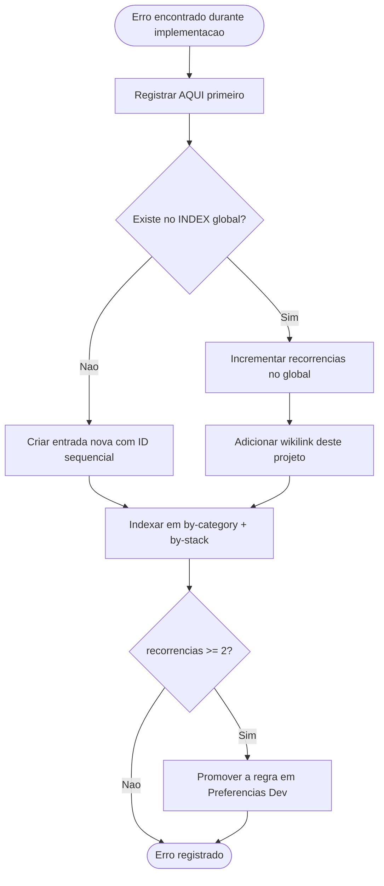

# 🐛 06-Erros — Site e Hub da Clínica Dr. Gabriel Cavalcanti

> **Nota de Uso:** Inicializado pelo `[[Protocol-Bootstrap]]`. Toda entrada é propagada para a memória imunológica global.
>
> ⚠️ **ESPELHADO EM MEMÓRIA IMUNOLÓGICA GLOBAL.** Toda entrada aqui deve ser propagada para `[[4 - Error's Memory/INDEX]]` seguindo o protocolo de deduplicação de `[[Immunological Error Memory]]`.
>
> ⚠️ **Schema obrigatório:** idêntico ao do `[[Immunological Error Memory]]`. Não simplificar campos.

---

## Erros do Projeto

```yaml
- id: ERR-2026-0008
  título: "Conexão Neon criada no import do módulo quebra o build sem DATABASE_URL"
  categoria: Deployment
  stack:
    - Next.js
    - Neon
    - Drizzle
  severidade: média
  projeto_origem: "Saude/Dr-Gabriel-Cavalcante"
  data_descoberta: 2026-09-18
  sintoma: "next build falha em ambiente sem DATABASE_URL; neon('') lança 'No database connection string was provided'"
  causa_raiz: "src/db/index.ts chamava neon(process.env.DATABASE_URL || '') no topo do módulo, então qualquer import — inclusive o que o build faz para tracing de rotas — exigia a variável"
  solução: "Criar o cliente sob demanda em getDb() e exportar `db` como proxy fino que delega, preservando os ~20 imports existentes"
  prevenção: "Nenhum módulo de servidor deve abrir conexão, ler env ou criar cliente no corpo do módulo. Conexão nasce na primeira chamada. Coberto por teste: importar o módulo sem env não pode lançar."
  recorrências: 0
  links:
    - "[[Dev/2 - Projects/Saude/Dr-Gabriel-Cavalcante/06-Erros|Dr-Gabriel-Cavalcante/06-Erros]]"
    - "[[deployment|Deployment]]"
    - "[[postgresql|PostgreSQL]]"

# Candidatos observados no onboarding, a registrar se reincidirem:
# - Sessões assinadas com segredo de fallback no código quando JWT_SECRET faltava (corrigido na F0, PR #1)
# - App local apontando para o branch Neon `production` (corrigido em 2026-09-17)
# - `skills add vercel/next.js` falha no Windows por limite de caminho (contornado com core.longpaths via env)
```

---

## Quality Gate (antes de propagar)

- [x] Artefato foi gerado a partir de `[[Errors Template]]` como base
- [x] ID consultado no `[[4 - Error's Memory/INDEX]]` (não duplicar) — ERR-2026-0008, próximo livre após 0007
- [x] Todos os campos obrigatórios preenchidos (`sintoma`, `causa_raiz`, `solução`, `prevenção`)
- [x] `stack` lista pelo menos uma tecnologia — Next.js, Neon, Drizzle
- [x] `severidade` definida (não vazio) — média
- [x] Entrada criada em `[[INDEX]]` global + `by-category/deployment` + `by-stack/postgresql`
- [x] Propagado para a memória imunológica global em 2026-09-21

---

## Fluxo de Propagação



> Protocolo completo: `[[Immunological Error Memory]]`

---

## Referências

- `[[Immunological Error Memory]]` — protocolo global
- `[[4 - Error's Memory/INDEX]]` — catálogo global
- `[[Preferencias Dev]]` — destino das regras promovidas (recorrências >= 2)
- `[[Protocol-Bootstrap]]` — protocolo que inicializa este arquivo
