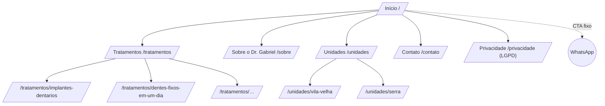

# 🧭 05 — Arquitetura da Informação (F1)

> Plano geral: [[00-Diagnostico-Inicial]]. Hero: [[Hero-Door-Reveal]].
> **Princípio:** usar os padrões que pacientes e secretárias já conhecem. Nada de menu criativo ou rótulo "esperto".
> Toda tela responde a uma pergunta de alguém; se ninguém pergunta, a tela não existe.

---

## 1. Quem usa e o que precisa resolver

| Pessoa | Pergunta que traz | O que resolve |
|---|---|---|
| **Paciente em potencial** (perdeu dentes, tem vergonha de sorrir, 40+ anos, pesquisa pelo celular) | "Isso resolve o meu caso? Posso confiar? Onde fica? Quanto tempo/quanto custa?" | Tratamentos, Sobre, Unidades, FAQ, WhatsApp |
| **Paciente atual** | "Onde é a consulta? Como remarco?" | Unidades, WhatsApp |
| **Doutor (OWNER)** | "Como está a semana? Quanto entrou? Quero mudar um texto/foto/preço." | Agenda, Relatórios, Configurações |
| **Equipe (STAFF)** | "Quem vem hoje? Em qual unidade? Encaixo alguém às 15h?" | Agenda, Pacientes |

---

## 2. Site público — mapa

- **Menu (5 itens + CTA):** Início · Tratamentos · Sobre · Unidades · Contato · **[Agendar avaliação]**.
  - **Mobile:** menu hambúrguer + **botão de WhatsApp fixo** no rodapé da tela (polegar).
- **Sem "Área da equipe" no menu:** o acesso ao hub fica só no rodapé, discreto.
- **Uma página por tratamento** porque cada tratamento é uma busca diferente no Google ("implante dentário Vila Velha", "prótese protocolo Serra").
- **Uma página por unidade:** endereço, mapa, como chegar/estacionar, dias de atendimento e um `Dentist` JSON-LD por endereço.
- **`/privacidade`** é obrigatória: o site coleta dados (formulário/agendamento) e a clínica trata dado de saúde.

### 2.1 Home — ordem das seções (funil)

| # | Seção | Técnica | Base na copy atual |
|---|---|---|---|
| 1 | **Hero "A Porta"** + headline + CTA | Promessa de resultado em 1 frase + ação | "Dentes fixos em um dia" |
| 2 | **"Isso é pra você se…"** | Identificação com a dor (PAS: problema) | "Eu devo fazer se…" (4 dores) |
| 3 | **Tratamentos** (3–6 cards) | Solução, com benefício antes da técnica | — |
| 4 | **Como funciona** (3–4 passos) | Reduz medo do desconhecido | — |
| 5 | **Quem é o Dr. Gabriel** | Autoridade (formação, +10 anos, hospital) | Bio atual (UFES, UFMG, PUC-MG) |
| 6 | **Depoimentos** | Prova social | "Confira os resultados" |
| 7 | **Garantia / acompanhamento** | Reversão de risco | "Garantia vitalícia" ⚠️ validar |
| 8 | **FAQ** | Quebra de objeções | — |
| 9 | **Unidades** (2 cards + mapa) | Remove atrito "onde fica?" | Endereços atuais |
| 10 | **CTA final** | Repetição da ação principal | "Sorriso novo agora" |

### 2.2 Estrutura de copy (base atual → versão com técnica)

Regras: fala do **resultado do paciente**, não da técnica · frases curtas · 1 ideia por bloco ·
todo botão = ação + benefício · nada de CAIXA ALTA gritando em parágrafo · PT-BR simples.
**Limite ético (CFO):** nada de promessa de resultado garantido, "antes e depois" só com autorização
e dentro das regras, sem preço como chamariz. Validar com o doutor/CRO-ES.

| Bloco | Hoje | Proposta (rascunho, 1 opção de várias na F4) |
|---|---|---|
| Headline | "DENTES FIXOS EM UM DIA! VOLTE A SORRIR COM LIBERDADE!" | **"Volte a sorrir, mastigar e conversar sem medo."** |
| Sub | "Pare de adiar: Seu sorriso fixo e autoconfiança de volta." | "Implantes e dentes fixos com o Dr. Gabriel Cavalcanti, cirurgião bucomaxilofacial com mais de 10 anos de experiência em Vila Velha e Serra." |
| CTA | "SORRISO NOVO AGORA!" (repetido 7x) | **"Agendar minha avaliação"** (1 CTA principal) + "Tirar dúvidas no WhatsApp" (secundário) |
| Dores | 4 itens "Tenho vergonha…" | Mantém as 4, na voz do paciente, com uma frase-ponte: "Se você se reconheceu em algum desses pontos, existe solução, e ela pode ser mais simples do que parece." |
| Autoridade | Parágrafo único | Chips de prova: **UFES · Bucomaxilo UFMG · Mestre em Implantodontia PUC-MG · +10 anos · Atuação hospitalar** + 2 frases humanas |
| Garantia | "Garantia vitalícia nos implantes" | ⚠️ Só se o doutor confirmar os termos por escrito. Alternativa: **"Acompanhamento para a vida toda: revisões semestrais para seu implante durar."** |

**FAQ (objeções a cobrir):** Dói? · Quanto tempo leva? · "Dentes fixos em um dia" vale para o meu caso? ·
Tenho pouco osso, posso fazer? · Tenho diabetes/pressão alta, posso fazer? · Quanto custa / tem parcelamento? ·
Precisa de anestesia geral? · Como são as revisões? · Atende convênio?

---

## 3. Hub — mapa e permissões

**Menu principal (sidebar no desktop · bottom-nav ≤ 5 no mobile):**

| Item | Rota | Hoje | Mudança |
|---|---|---|---|
| **Agenda** | `/hub/agenda` | Agenda | + filtro por **unidade** |
| **Pacientes** | `/hub/pacientes` | "Clientes" (derivado dos agendamentos) | Renomear e ligar à tabela `patients` + ficha (dados, histórico, odontograma) |
| **Financeiro** | `/hub/financeiro` | — | Novo (F7): recebimentos, parcelas, pendências |
| **Relatórios** | `/hub/relatorios` | "Dashboard" | Renomear ("Dashboard" é jargão) |
| **Configurações** | `/hub/configuracoes` | "Serviços" e "Horários" soltos no menu | Agrupa tudo que é "ajustar uma vez e esquecer" |

**Configurações (abas):** Clínica · **Unidades** · Horários (por unidade) · Tratamentos (o que o site mostra + o que a agenda usa) · **Site** (textos, fotos, depoimentos, FAQ, WhatsApp) · Equipe · Minha conta.

> Por que tirar Serviços e Horários do menu: são configurados raramente. No menu eles competem com
> o que é usado toda hora (Agenda, Pacientes). É o padrão de sistemas que a equipe já conhece.

### 3.1 Permissões

| Área | OWNER (doutor) | STAFF (equipe) |
|---|---|---|
| Agenda (ver/criar/mover/status) | ✅ | ✅ |
| Pacientes (dados e histórico) | ✅ | ✅ |
| Odontograma / prontuário | ✅ | 👁️ só leitura (a confirmar) |
| Financeiro | ✅ | ⚠️ lançar recebimento, sem relatório (a confirmar) |
| Relatórios | ✅ | ❌ |
| Configurações → Clínica, Unidades, Horários, Tratamentos, Site | ✅ | ❌ |
| Configurações → Equipe | ✅ | ❌ |
| Minha conta (senha, nome) | ✅ | ✅ |

A regra vale **na API** (403), e a UI só esconde o que não pode ser usado.

---

## 4. Fluxos principais

1. **Paciente → avaliação (MVP):** página → "Agendar minha avaliação" → WhatsApp com mensagem pronta
   ("Olá! Vim pelo site e quero agendar uma avaliação na unidade {Vila Velha|Serra}.") → a equipe agenda no hub.
2. **Paciente → agendamento online (fase posterior, se `allowCustomerBooking`):** tratamento → unidade →
   dia/horário livre → nome + telefone + aceite LGPD → confirmação.
   **Decisão:** começa só por WhatsApp. É como o público dele já agenda, e evita horário falso na agenda.
3. **Equipe → encaixe:** Agenda → filtra unidade → clica no horário → busca paciente (ou cria) → tratamento → salvar.
4. **Doutor → trocar um texto/foto do site:** Configurações → Site → edita → **pré-visualizar** → publicar.
   Sem precisar do dev.

---

## 5. Mudanças de dados (para F5/F7)

| Mudança | Por quê |
|---|---|
| **`units`** (nome, slug, endereço, telefone, link do mapa, ativo) | Duas unidades |
| `business_hours.unit_id` (+ `unique(unit_id, day_of_week)`) e `business_date_overrides.unit_id` | Horário por unidade |
| `appointments.unit_id` | Saber onde é a consulta; filtro na agenda |
| `services` → + `slug`, `show_on_site`, `summary`, `body`, `sort_order` | O mesmo cadastro alimenta site e agenda |
| **`site_content`** (chave/valor tipado: headline, sub, bio, WhatsApp…), **`testimonials`**, **`faqs`** | Doutor edita o site |
| `users.role` ∈ OWNER/STAFF (✅ F0) | Permissões |
| `payments` (F7), `audit_log` (F7) | Financeiro e rastreabilidade (LGPD) |

Migrações sempre no branch **`dev`** do Neon → validar → aplicar em `production`.

---

## 6. Nomenclatura (glossário único)

| Usar | Não usar | Motivo |
|---|---|---|
| Paciente | Cliente | Linguagem da área da saúde |
| Tratamento | Serviço / procedimento (no site) | É o que o paciente busca |
| Avaliação | Consulta inicial / orçamento | Termo usado na odonto |
| Unidade | Filial / clínica | Claro para o paciente |
| Relatórios | Dashboard | Sem jargão |
| Equipe | Usuários | Humano |

---

## 7. Fora do escopo agora
Blog · área do paciente com login · pagamento online · multi-profissional com agendas separadas.
(Entram só se houver demanda real.)

---

## 8. Perguntas para o doutor (bloqueiam F4/F5)
1. **Lista de tratamentos** que quer divulgar (e quais são carro-chefe).
2. Em **quais dias** atende em cada unidade? A equipe é a mesma nas duas?
3. **"Garantia vitalícia":** quais são os termos exatos? Pode divulgar?
4. **Depoimentos:** tem depoimentos autorizados por escrito (texto/vídeo)?
5. **WhatsApp:** um número para as duas unidades ou um por unidade?
6. STAFF pode ver prontuário/odontograma? E lançar recebimentos?
7. Atende convênio? Trabalha com parcelamento?
